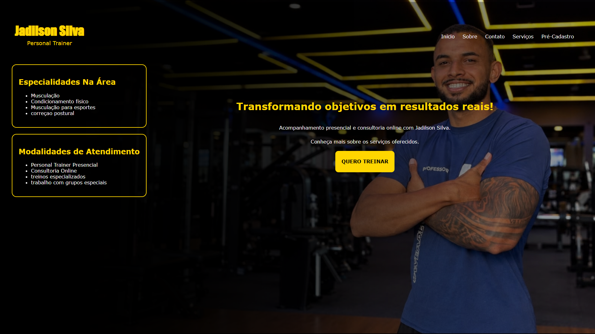
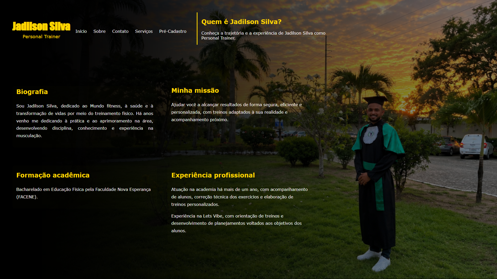
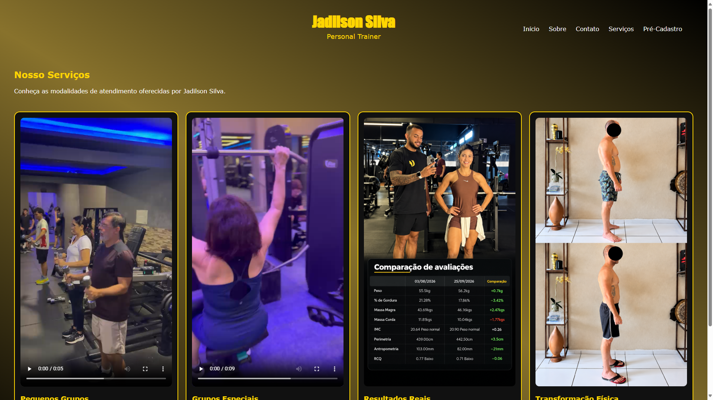
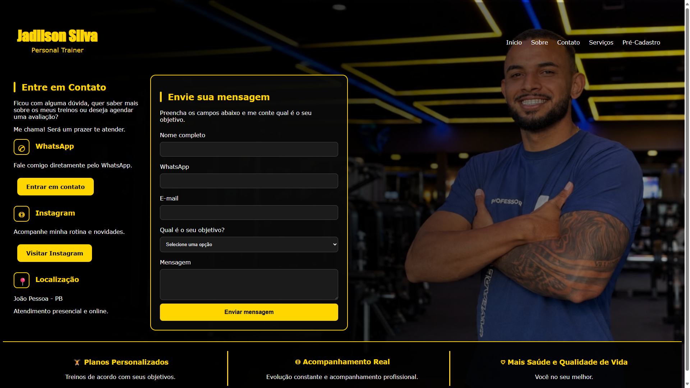

# Jadilson Silva — Personal Trainer

Site profissional desenvolvido para apresentar os serviços do personal trainer Jadilson Silva, divulgar suas especialidades e facilitar o contato com pessoas interessadas em iniciar um acompanhamento de treinamento.

O projeto faz parte dos meus estudos em Ciência da Computação e representa minha prática no desenvolvimento web.

## 🎯 Objetivo

Criar uma página web profissional, moderna e responsiva, que apresente o trabalho do personal trainer, seus serviços e as modalidades de atendimento presencial e online.

## 🛠️ Tecnologias utilizadas

- HTML5 — estruturação e organização do conteúdo.
- CSS3 — estilização, identidade visual e responsividade.

## 📌 Funcionalidades e páginas

- **Página inicial:** apresentação do profissional e chamada para conhecer os serviços.
- **Sobre:** biografia, formação acadêmica, experiência profissional e missão.
- **Serviços:** apresentação dos serviços por meio de imagens, vídeos e descrições.
- **Contato:** informações para entrar em contato com o profissional.
- **Pré-cadastro:** registro de pessoas interessadas nos planos de treinamento.

## 📷 Evidências do projeto

## 🎨 Identidade visual

O projeto utiliza uma identidade visual baseada principalmente nas cores preto e amarelo, buscando transmitir profissionalismo, modernidade e destaque para as informações.

O layout foi desenvolvido considerando diferentes tamanhos de tela, incluindo computadores e dispositivos móveis.

## 👨‍💻 Minha contribuição

Neste projeto, fui responsável por:

- Desenvolver a estrutura das páginas utilizando HTML5.
- Criar e organizar os estilos utilizando CSS3.
- Desenvolver a navegação entre as páginas.
- Trabalhar na identidade visual do site.
- Adaptar o layout para dispositivos móveis.
- Organizar os conteúdos e elementos visuais.
- Construir as páginas de apresentação, serviços e contato.

## 📚 Aprendizados

Durante o desenvolvimento, pratiquei conceitos de HTML5, CSS3, organização de arquivos, estruturação de páginas, navegação entre conteúdos e responsividade.

O projeto também contribuiu para desenvolver minha capacidade de transformar uma necessidade real em uma solução web.

## 🚀 Próximos ajustes

- Continuar aprimorando a responsividade.
- Melhorar a organização e a apresentação do código.
- Evoluir as funcionalidades do projeto conforme os estudos.

## 🔗 Acesso ao projeto

[Repositório no GitHub](https://github.com/niedson007/projeto-em-desenvolvimento)

---
## 📫 Contato

- **GitHub:** [@niedson007](https://github.com/niedson007)
- **LinkedIn:** [Niedson Samuel](https://www.linkedin.com/in/niedson-samuel-250990431/)

---
Desenvolvido por **Niedson Samuel**.
*Projeto em desenvolvimento — aprendizado contínuo em Desenvolvimento Web.*
